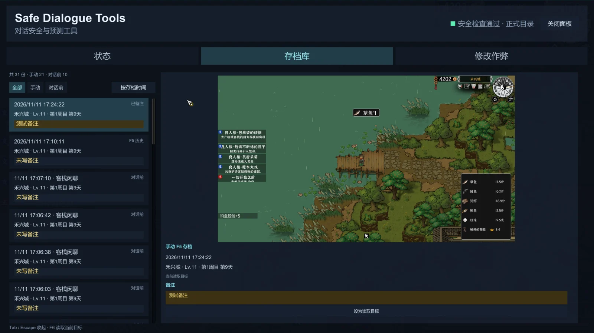
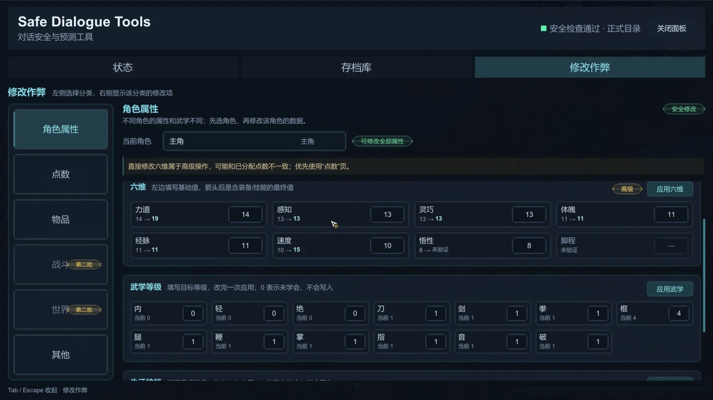
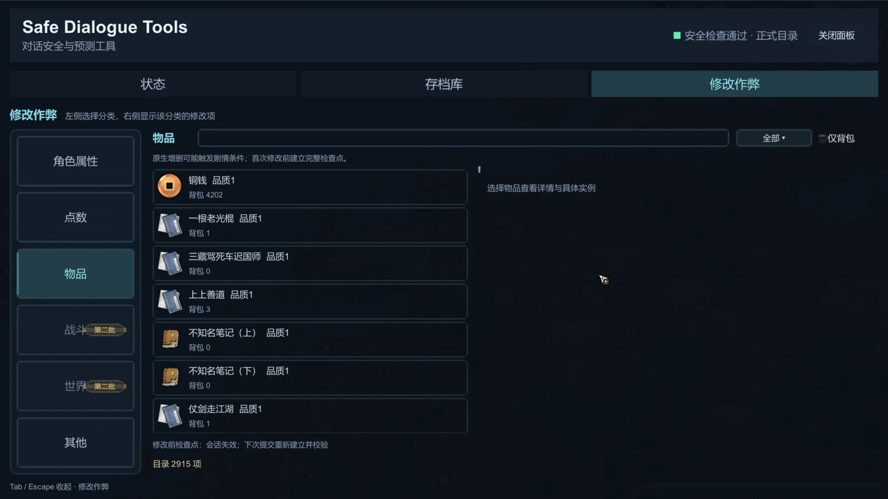

<div align="center">

# Beast-Saga-better

《灵兽江湖 / Beast Saga》的安全对话与存档工具<br>
先看清结果，再决定要不要选。

[](https://github.com/Scholarpei/Beast-Saga-better)
[](https://store.steampowered.com/app/2232880/Beast_Saga)
[](https://learn.microsoft.com/windows/)
[](https://dotnet.microsoft.com/)
[](https://bepinex.dev/)
[](#验证)

</div>

## 它解决什么问题

RPG 对话最大的成本不是读文本，而是选错以后不知道要回溯多远。Beast-Saga-better 在选项旁边直接给出判定结果、奖励消耗和剧情影响；配合独立的检查点库，你可以回到对话前的状态，也可以在修改角色、点数和物品前先留一条明确的退路。

它不自动替你选“最优解”，也不把未知剧情猜成已知。条件看不懂、脚本有副作用或状态不适合保存时，工具会显示原因并停下。


## 核心功能

### 1. 判定与剧情预测

把鼠标停在一个选项上，悬浮窗会显示：

| 预测内容  | 说明                     |
| ----- | ---------------------- |
| 判定成功率 | 按当前队伍计算属性、生活技能、队友与说服修正 |
| 物品变化  | 获得、消耗、品质颜色、材料是否足够      |
| 角色影响  | 好感、入队、离队、经验、悟性、属性、生活经验 |
| 武学与任务 | 新武功、内功、技能转移、任务状态与步骤变化  |
| 分支结果  | 共同结果与各分支差异分开列出         |
| 危险边界  | 战斗、地图切换、商店、立即存档处停止继续预测 |

提交材料的例子：

```text
✓ 2纯铁矿 3 ≥ 3
失去：2纯铁矿 ×3
获得：5光棍图纸 ×1
任务：采集纯铁矿 → success
✓ 会完成任务：采集纯铁矿
```

材料不足时会直接写明本次不能完成任务；有回溯选项的对话会保留当前选项的奖励，不把“让我再想想”“返回再选”的路径混进去。

### 2. 检查点与存档库

稳定场景按 `F5` 创建完整检查点，`F6` 通过游戏官方整场景读取流程恢复地图、玩家和必要运行状态。进入可安全捕获的对话前，工具会自动保存“对话前”状态；对话中按 `F5` 是选择这个检查点，而不是另存一份。



存档库支持：

- 全部 / 手动 / 对话前筛选，以及按存档时间排序；
- 缩略截图、时间、地图、等级、周目和对话标题；
- 给检查点写备注；已备注的手动历史不占默认保留额度；
- 将任意检查点设为读取目标；
- 对话前检查点落盘保存，重启游戏后仍可查看和选择。

手动历史默认保留 50 份，对话前检查点默认保留 10 代。检查点目录与游戏原生 `Auto*`、`Note*`、`quick*` 存档位分开；损坏的检查点不会被替换成其他存档。

### 3. 快捷工具面板

按 `Tab` 打开面板，`Tab` 或 `Esc` 收起。面板分为状态、存档库和修改作弊三页。

状态页显示运行模式、检查点、读取目标、暂不可用原因和快速操作。修改作弊页按角色属性、点数、物品、战斗、世界、其他分类组织；战斗和世界功能仍标记为第二批。

### 4. 角色与点数修改



- 选择主角、已招募队友或已认识角色；
- 主角和已招募队友支持批量修改六维、武学等级和生活技能等级；
- 已认识但未入队的角色只开放好感度；
- 属性点、特性点支持增加、减少或直接设为可用值；
- 生活点由生活技能等级换算，保持只读；
- 六维显示基础值和含装备、技能后的最终值；悟性与脚程的最终值未经游戏证实时不显示；
- 钓鱼直接成功和当前场景移动速度调整在“其他”页。

直接修改六维属于高级操作，可能与已经分配的点数不一致，界面上会提示优先使用“点数”页。

### 5. 物品修改



物品页支持名称和描述搜索、分类筛选、仅背包筛选、原生图标、详情查看、数量添加与移除。任务类物品和信件只能浏览，不允许增删。装备移除只作用于背包里明确选定的具体实例，排除已穿戴及标记“锁定熔解”的实例。

首次物品增删前会创建并完整校验检查点；同一次面板会话内复用该检查点，关闭面板或读档后重新建立。原生增删仍可能触发剧情条件，检查点是回退这条路的保障，不是“绝对不会影响剧情”的承诺。

## 安全设计

- 只静态解析受限的常量脚本，不执行 Lua、原生奖励函数或有副作用的判定函数；
- 战斗、转场、加载未完成、原生存档写入或状态无法确认时拒绝存读档；
- 修改功能只在游戏可操作、非战斗、非地图切换、非对话和剧情演出时启用；
- 面板操作复用原有安全检查，不绕过存读档限制；
- 部署脚本会先跑完整测试和 Release 构建，备份旧 DLL，再复制新 DLL 并校验哈希。

## 安装

### 从 Release 安装

1. 安装适用于《灵兽江湖》的 BepInEx IL2CPP 环境；
2. 将发行包中的 `BeastSagaBetter.dll` 放入：

```text
BepInEx/plugins/BeastSagaBetter/BeastSagaBetter.dll
```

3. 启动游戏后按 `Tab` 检查面板是否可用。

配置文件位于：

```text
BepInEx/config/scholarpei.beast-saga-better.cfg
```

对话前 SL 需要同时满足两个条件：配置中的 `EnableCheckpoints` 为 `true`，且正式游戏根目录存在 `SAFE_DIALOGUE_PRODUCTION_SL_AUTHORIZED` 授权标记。删除标记或关闭配置即可回到原生 `F5` / `F6` 行为。

### 从源码部署

```powershell
./tools/deploy-production.ps1
```

脚本要求先退出游戏，默认执行完整测试与 Release 构建；已自行测试或构建时可加 `-SkipTests`、`-SkipBuild`。

## 快捷键

| 按键    | 作用                      |
| ----- | ----------------------- |
| `Tab` | 打开 / 收起工具面板             |
| `Esc` | 面板打开时收起面板               |
| `F5`  | 稳定场景创建检查点；对话中选择“对话前”检查点 |
| `F6`  | 读取已选定的检查点               |

按键可在配置文件 `Keys` 分区调整。

## 数据位置

```text
BeastSagaBetterData/
├── checkpoints/   # 手动与对话前检查点
└── load-work/     # 读档工作数据
```

如果游戏根目录没有新目录但存在旧版 `SafeDialogueToolsData/`，工具会继续读取旧目录，已有检查点不会丢失。插件不占用、不覆盖游戏原生存档位及其截图。

## 卸载与降级

退出游戏后移走整个 `BepInEx/plugins/BeastSagaBetter/` 目录即可。要临时停用对话前 SL，可以删除 `SAFE_DIALOGUE_PRODUCTION_SL_AUTHORIZED`，或把 `EnableCheckpoints` 改回 `false`。

## 验证

自动化测试覆盖检查点历史、读取策略、判定展示、面板布局、角色、点数和物品修改。当前测试集为 177 项。

有限场景通过不等于所有剧情旗标、战斗触发器和磁盘异常都已覆盖。遇到读档卡住或状态异常时，先停用对话前 SL 并保留现场，再反馈日志与检查点目录结构。

## 许可与致谢

本项目依赖 [BepInEx](https://bepinex.dev/) 与 Harmony。《灵兽江湖》及相关游戏资源归其权利人所有，本仓库只提供社区工具。

## 反馈

优先提交 [GitHub Issue](https://github.com/Scholarpei/Beast-Saga-better/issues)，并附上：

- 游戏版本与 BepInEx 日志；
- 触发场景、对话名称和截图；
- 是否启用了对话前 SL；
- 已经执行过的恢复操作。
